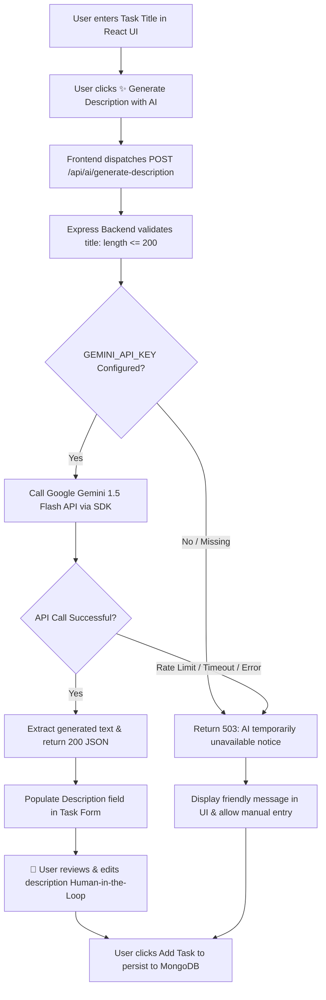

# Practical 13 - AI Integration in a Full-Stack Task Management Application

This repository contains Practical 13: an AI-augmented full-stack Task Management application featuring **AI-Powered Task Description Generation** utilizing Google's Gemini API (`@google/generative-ai`), built upon an Express + MongoDB backend and a modern React + Vite frontend.

---

## 🎯 Aim

To integrate an external AI service (Google Gemini API) into the existing full-stack Task Management application and demonstrate responsible AI engineering practices, including human oversight, privacy, security, transparency, and error resilience.

---

## 📁 Project Structure

```text
pra-13/
├── backend/                  # Express REST API Server with Gemini AI Integration
│   ├── models/               # Mongoose Data Models (Task.js)
│   ├── tests/                # Automated Schema Unit Tests (task.test.js)
│   ├── .dockerignore         # Docker context exclusions
│   ├── .env.example          # Sample environment variables (GEMINI_API_KEY placeholder)
│   ├── Dockerfile            # Lightweight Node.js 20 Alpine container image
│   ├── package.json          # Backend dependencies (@google/generative-ai, express, mongoose)
│   └── server.js             # Express server with /api/ai/generate-description endpoint
├── frontend/                 # React Single Page Application (Vite)
│   ├── public/               # Static assets & icons
│   ├── src/                  # React components, pages, and styles
│   │   ├── pages/            # Home, Projects (Task Manager with AI button), Contact
│   │   ├── api.js            # API client with generateTaskDescription() integration
│   │   ├── App.css           # Styling with AI action bar & gradient sparkle buttons
│   │   ├── App.jsx           # App router with React.lazy & Suspense
│   │   └── main.jsx          # Application entry point
│   ├── .dockerignore         # Docker context exclusions
│   ├── .gitignore            # Git exclusions
│   ├── Dockerfile            # Multi-stage build (Node 20 build -> Nginx Alpine runtime)
│   ├── package.json          # Frontend dependencies & build scripts
│   └── vite.config.js        # Vite bundler configuration
├── docker-compose.yml        # Multi-container orchestration (Frontend, Backend, MongoDB)
├── .gitignore                # Git exclusions
└── README.md                 # Practical documentation
```

---

## ⚡ Architecture Flow Diagram



---

## 🤖 Responsible AI Implementation

| Principle | Implementation in Code |
| :--- | :--- |
| **1. Human Oversight** | The AI-generated text is placed into an editable `<textarea>`. The user reviews, edits, or deletes it before submitting the task. |
| **2. Privacy Protection** | Only the task title string is sent to the Gemini API. No user credentials, database IDs, or sensitive information are shared. |
| **3. API Key Security** | The `GEMINI_API_KEY` is strictly confined to `backend/.env`. It is **never** prefixed with `VITE_` or exposed to client-side bundles. |
| **4. Transparency** | A visible notice badge informs the user: *"✨ Description generated by AI. You can review and edit it before adding the task."* |
| **5. Cost Control** | Strict validation limits titles to $\le 200$ characters, and the generation config limits `maxOutputTokens` to $150$. |
| **6. Error Resilience** | If the AI service is unreachable or unconfigured, an inline notice appears, and standard manual task creation remains 100% operational. |

---

## 🚀 Getting Started

### 1. Environment Configuration

Create a `.env` file inside `pra-13/backend/` (or copy from `.env.example`):

```env
PORT=5000
MONGO_URI=mongodb://localhost:27017/taskmanager
GEMINI_API_KEY=your_actual_gemini_api_key_here
```

> [!NOTE]
> If you do not possess an active Gemini API key, leave the placeholder value. The application will gracefully fallback to manual entry and inform you via a user-friendly UI message without crashing.

---

### 2. Running Locally

#### Backend Setup
```bash
cd backend
npm install
npm run dev   # or npm start
```

#### Frontend Setup
```bash
cd frontend
npm install
npm run dev
```

Open your browser at **`http://localhost:5173`**.

---

### 3. Running with Docker Compose

```bash
docker compose up --build
```

---

## 🔌 API Endpoints

| Method | Endpoint | Description |
| :--- | :--- | :--- |
| `POST` | `/api/ai/generate-description` | Accepts `{ title }`, prompts Gemini 1.5 Flash, and returns `{ description }`. |
| `GET` | `/tasks` | Retrieves all tasks (cached with 60s TTL). |
| `POST` | `/tasks` | Creates a new task and dispatches an asynchronous background notification. |
| `PUT` | `/tasks/:id` | Updates an existing task. |
| `DELETE` | `/tasks/:id` | Deletes a task. |
| `GET` | `/debug/cache` | Returns cache hit/miss statistics. |

---

## 🛠️ Tech Stack

- **AI Provider**: Google Gemini API (`@google/generative-ai`, `gemini-1.5-flash`)
- **Frontend**: React 19, Vite, React Router DOM, Modern CSS
- **Backend**: Node.js 20, Express 5, Mongoose ORM, `node-cache`, `EventEmitter`
- **Database**: MongoDB 7
- **Containerization**: Docker, Docker Compose, Multi-stage Nginx builds
